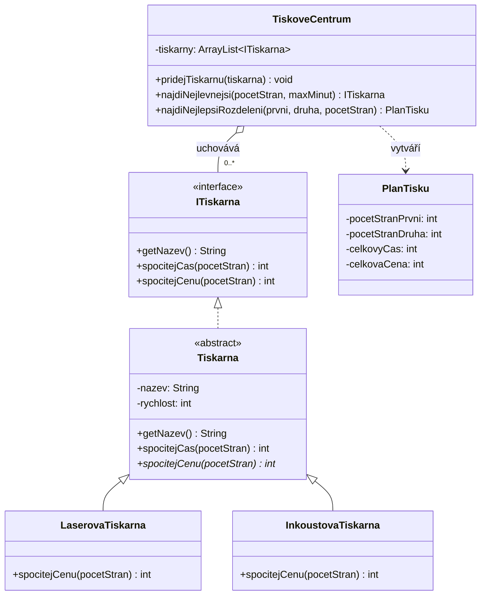

# Školní tiskárny — UML a spuštění

## UML diagram



## Spuštění

V adresáři s `Main.java`:

```bash
javac Main.java
java Main
```

Všechny třídy jsou záměrně v jednom zdrojovém souboru, takže lze program snadno zkompilovat jedním příkazem. `TiskoveCentrum` pracuje s tiskárnami pouze přes rozhraní `ITiskarna`.
